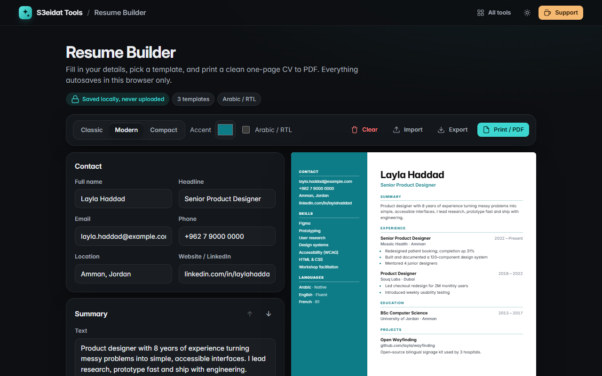

# Resume Builder

> A clean one-page CV you can print to PDF. Free, private, and it runs entirely in your browser.

### ▶ [Open Resume Builder](https://s3eidat.github.io/resume-builder/)



## Features

- Sections: contact, summary, experience, education, skills, projects, languages
- **Reorder sections** with the arrows; empty sections are left out of the page
- **3 templates**: Classic (centred header), Modern (coloured sidebar), Compact (dense two-column)
- **Accent colour** of your choice
- Lines that start with `-` or `•` become bullet points
- **Arabic / RTL** toggle: right-to-left layout and Arabic section headings
- **Live A4 preview** and **Print / PDF** (only the CV prints, no app chrome)
- **Autosaves** in this browser; **export / import JSON** to back up or move your CV (imported files are validated)

## Privacy

Your CV never leaves your device. It is stored in your browser's localStorage, with no server, no account
and no analytics. The page ships with a strict Content-Security-Policy (`connect-src 'self'`), so the browser
itself blocks any attempt to send data anywhere. Clearing your browser data deletes it, so export a backup.

## Run it yourself

It's plain HTML, CSS and JavaScript with no build step:

```bash
git clone https://github.com/s3eidat/resume-builder
cd resume-builder
python -m http.server 8000
```

Then open http://localhost:8000.

## Support

If this saved you time, **[buy me a coffee ☕](https://s3eidat.github.io/coffee/)**. It keeps every tool free.

---

Part of **[S3eidat Tools](https://s3eidat.github.io/)**: 100+ free, private tools that run in your browser. MIT licensed.
